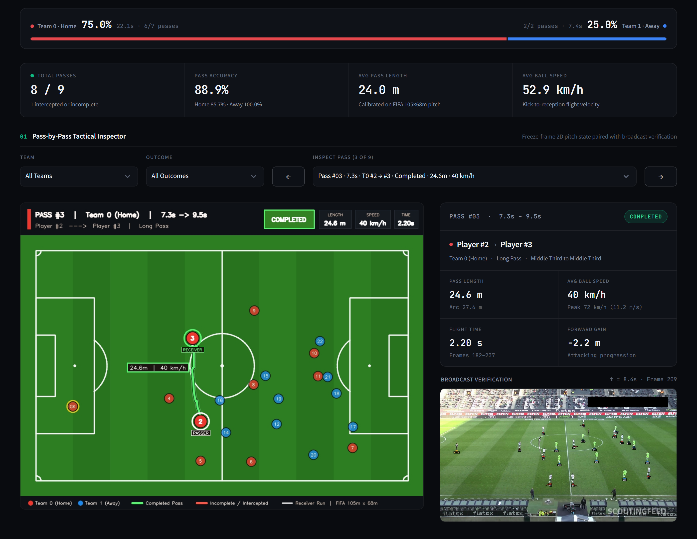
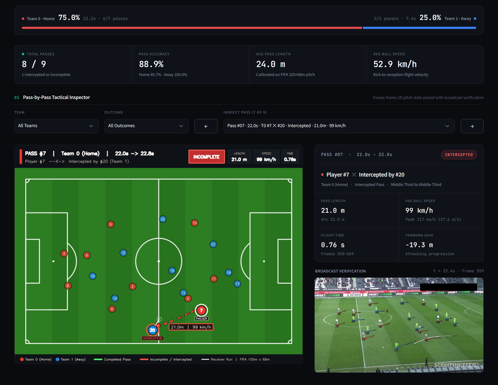
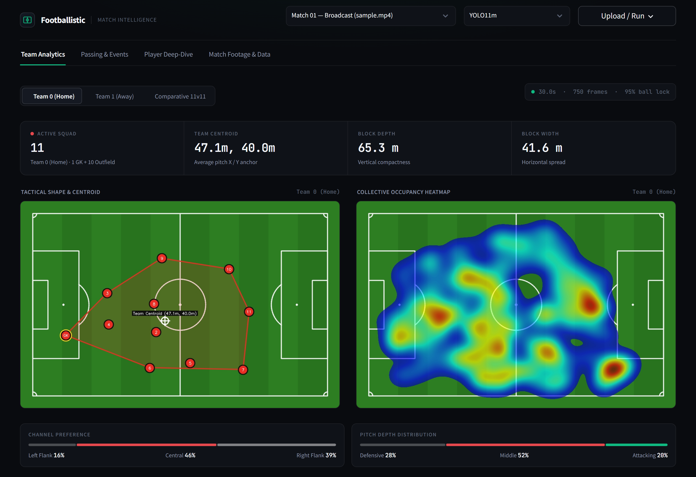
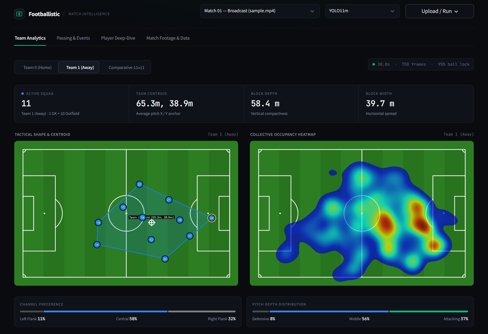
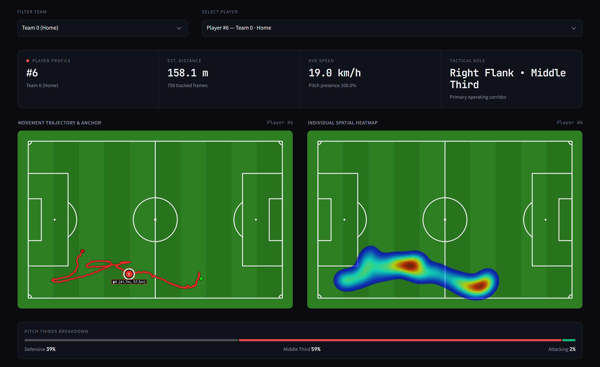
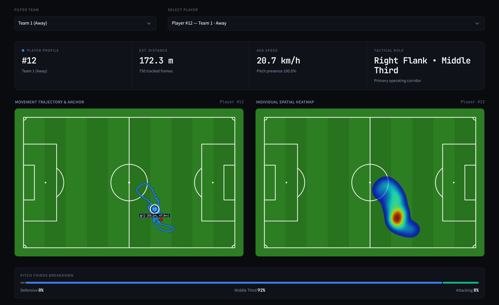
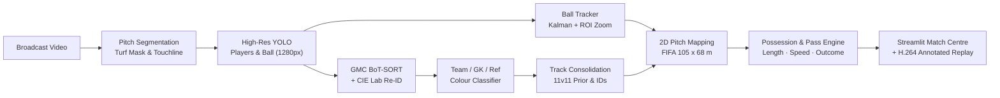

<div align="center">

# Footballistic

### Broadcast-grade football analytics from a single camera feed

Detect and track every player and the ball, classify teams and goalkeepers, project play onto a 2D FIFA pitch,<br>
and break down every pass — **who, to whom, how far, how fast, and whether it arrived.**

[](https://www.python.org/)
[](https://github.com/ultralytics/ultralytics)
[](https://github.com/ultralytics/ultralytics)
[](https://streamlit.io/)
[](LICENSE)

<br>


<sub>First 12 seconds of an analysed Bundesliga broadcast clip — stable player IDs, team colours, camera-compensated movement trails, and a white ball trail.
<a href="docs/assets/demo_sample_12s.mp4">Download full-quality MP4 &rarr;</a></sub>

</div>

---

## Overview

Elite match analytics (Opta, StatsBomb, Second Spectrum) relies on manual event annotation or dedicated multi-camera optical arrays inside stadiums.
**Footballistic** explores how much of that tactical intelligence can be extracted automatically from a single broadcast camera feed.

| Capability | Details |
|---|---|
| **Full-pitch player tracking** | Detects both near and far-touchline players and preserves IDs across fast camera pans |
| **Dedicated ball tracking** | Camera-compensated Kalman filter + native-resolution ROI zoom (~95% frame lock on the demo clip) |
| **Team & role classification** | Grass-subtracted jersey clustering separates Home, Away, Goalkeepers, referees, and touchline staff |
| **2D pitch projection** | Perspective-aware mapping onto a standard 105 &times; 68 m FIFA pitch for formations and heatmaps |
| **Physics-verified pass telemetry** | Exact kick-to-reception length (m), average & peak ball speed (km/h), flight time, and outcome |
| **Interactive match centre** | Minimalist dark Streamlit studio with pass-by-pass freeze-frames, overview maps, and CSV export |

---

## Dashboard Tour

### 01 &middot; Pass-by-Pass Tactical Inspector
Every detected pass receives a dedicated 2D freeze-frame showing all 22 players at the exact kick frame, the real curved ball trajectory, passer/receiver halos, calibrated length and speed, and a synchronized broadcast snapshot for direct visual verification. Step chronologically through passes with the `&larr;` / `&rarr;` controls.

<p align="center">
  
  
</p>
<p align="center"><sub><b>Left:</b> completed 24.6 m pass (#2 &rarr; #3). <b>Right:</b> pass by #7 intercepted by opponent #20 (dashed red path + &times; marker).</sub></p>

### 02 &middot; All-Passes Match Overview & Telemetry Log
All passes rendered onto one bird's-eye pitch — numbered circles mark kick origins matching the telemetry log (`green` = completed, `dashed red` = intercepted) — paired with the full exportable pass table (**From &rarr; To**, **Outcome**, **Length**, **Avg / Peak Speed**, **Duration**, and **Target Zone**).

<p align="center">
  
</p>
<p align="center">
  
</p>

### 03 &middot; Team Tactical Analytics
11v11 average formations, convex-hull team shape, centroid coordinates, block depth and width, collective occupancy heatmaps, and flank / pitch-depth distribution bars for Home, Away, or comparative views.

<p align="center">
  
  
</p>

### 04 &middot; Player Deep-Dive
Select any tracked player to inspect their full 2D movement trajectory, average anchor position, individual KDE heatmap, estimated distance covered, average speed, operating corridor, and pitch-thirds breakdown.

<p align="center">
  
  
</p>

---

## Pipeline Architecture



The engine runs in two passes: **Pass 1** performs detection, camera-compensated tracking, global tracklet stitching, and team classification (cached to `pass1_cache.pkl`); **Pass 2** renders the globally consistent H.264 broadcast replay and exports `spatial_data.json` plus per-pass 2D freeze-frames for instant dashboard loading.

---

## Engineering Challenges

Broadcast football presents tough failure modes for off-the-shelf vision pipelines. Key issues addressed in this codebase:

| Challenge | Solution |
|---|---|
| **Distant far-touchline players missed by default detectors** | Inference runs on the dynamically pitch-cropped region at `imgsz=1280` with a low confidence floor (`0.14`) and second-stage recovery |
| **Spectators, LED ad boards, dugouts, and coaches flagged as players** | Non-convex turf HSV segmentation (excluding emerald LED panels) combined with a RANSAC white near-touchline boundary filter |
| **Fast camera pans cause tracker ID switches** | BoT-SORT with `sparseOptFlow` global motion compensation (GMC), Stage-3 foot-distance + CIE Lab jersey Re-ID, and global tracklet consolidation under a FIFA 11-player prior |
| **Tiny, fast, frequently occluded football & static penalty-spot false positives** | Dedicated `BallTracker` using a GMC-Kalman filter, 1:1 native-resolution `320px` ROI zoom, motion/white-blob recovery, and unattended static penalty-spot rejection |
| **White kits blending into ad boards / neon-green kits blending into turf** | Local-turf-adaptive colour subtraction inside jersey crops plus lopsided-cluster protection in K-Means |
| **Long aerial switches falsely broken by bystanders underneath** | Kinematic fly-over filter verifying minimum in-spell deceleration and trajectory bend before, during, and after contact |
| **Halo-to-halo pass timing inflating ball speeds** | Exact kick-frame and reception-frame refinement pinpoints true departure and arrival timestamps for realistic speed (km/h) |

---

## Evaluation on Demo Clips

| Metric | `sample.mp4` (Broadcast) | `sample2.mp4` (Wide Tactical) |
|---|:---:|:---:|
| Players tracked | **22** (11 v 11) | **22** (11 v 11) |
| Ball frame coverage | **94.9%** (712 / 750 frames) | ~85–91% |
| Passes detected | **9** (8 completed &middot; 1 intercepted) | **5** (4 completed &middot; 1 intercepted) |
| Pass accuracy | 88.9% | 80.0% |
| Mean pass length / speed | 24.0 m &middot; 52.9 km/h | 29.1 m &middot; 39.6 km/h |
| Longest pass | **53.0 m** cross-field switch (`#8` &rarr; `#7`) | **63.6 m** long clearance (`#2` &times; `#12`) |

> Metrics reflect two 30-second validation clips used during development rather than a large-scale benchmark.

### Pass Length & Speed Calibration
1. **Exact timing:** The engine locates the last closest approach of the ball to the passer's foot before departure (`kick_frame`) and the first closest approach to the receiver or interceptor (`receive_frame`).
2. **Perspective scaling:** Camera pixel coordinates are warped onto a standard 105 &times; 68 m FIFA pitch using projective Y foreshortening and trapezoid width compensation.
3. **Telemetry:** Straight-line length (m), flight arc length (m), average speed (km/h = distance / true flight duration), and filtered peak velocity (km/h) are computed for every pass.

---

## Quick Start

```bash
git clone https://github.com/omerfarukyuce/Footballistic.git
cd Footballistic

python -m venv venv
venv\Scripts\activate          # Windows (Linux/macOS: source venv/bin/activate)
pip install -r requirements.txt
```

**1. Prepare footage and weights**  
Place a wide-angle or broadcast `.mp4` clip in `data/sample_videos/` (or download the demo clip with `python scripts/download_sample.py`) and ensure a YOLO checkpoint such as `yolo11m.pt` is available under `weights/`.

**2. Run the two-pass analytics pipeline**
```bash
python main.py --video data/sample_videos/sample.mp4 --output output
```

**3. Launch the Streamlit Match Centre**
```bash
streamlit run app.py
```

> Processed outputs (`output*/`), sample videos, and model weights are git-ignored; run step 2 once locally before opening the dashboard.

---

## Roadmap

### Phase 1 &mdash; Core Vision Pipeline &nbsp;`Completed`
- [x] High-resolution pitch-cropped YOLO detection with turf, LED-board, and touchline filtering
- [x] Camera-motion-compensated BoT-SORT with Lab Re-ID and 11v11 track consolidation
- [x] Dedicated ball tracker with ROI zoom, penalty-spot rejection, and white trajectory trail
- [x] Team, goalkeeper, and referee classification
- [x] 2D bird's-eye pitch mapping, formations, heatmaps, and atomic H.264 replay rendering

### Phase 2 &mdash; Event Detection & Pass Intelligence &nbsp;`Completed`
- [x] Dynamic frame-level player and team ball possession engine
- [x] Physics-verified pass detection (completed and intercepted) with calibrated length, speed, and per-pass 2D freeze-frame visuals
- [x] Interceptions, ball recoveries, progressive passes, final-third entries, and box entries

### Phase 3 &mdash; Physical & Tactical Metrics &nbsp;`In Progress`
- [x] Estimated distance covered, average speed, pitch presence, and third/channel splits
- [ ] Instantaneous speed zones, top speed, high-speed running, and sprint counts
- [ ] Time-series defensive line height, block compactness dynamics, and pressing pressure distance

### Phase 4 &mdash; Interactive Match Centre &nbsp;`In Progress`
- [x] Minimalist Obsidian dark Streamlit workspace with pass inspector (`←`/`→`), match overview map, telemetry log, and CSV export
- [ ] One-click printable HTML / PDF match scouting report

### Phase 5 &mdash; Pro-Grade Calibration &nbsp;`Planned`
- [ ] Automatic pitch-keypoint homography for exact metric projection across arbitrary camera zoom/pan
- [ ] Jersey-number OCR linking tracker IDs to matchday squad numbers

---

## Current Limitations

- **Perspective approximation:** 2D projection uses a calibrated perspective warp rather than per-frame line-keypoint homography, so distances and speeds are accurate estimates rather than optical survey ground truth.
- **2D ball tracking:** Aerial elevation is not modelled; lofted passes are projected onto the ground plane.
- **Anonymous IDs:** Player labels (`#1`–`#22`) are persistent per-clip identifiers rather than recognized shirt numbers.
- **Validation scope:** Tested thoroughly on two 30-second broadcast/tactical clips; broader multi-stadium evaluation is planned.
- **Hardware:** Runs on CPU out of the box; a CUDA GPU significantly accelerates Pass 1 inference.

---

## Repository Structure

```text
Footballistic/
├── .streamlit/config.toml            # Dark studio theme configuration
├── configs/football_botsort.yaml     # GMC BoT-SORT tracker settings
├── docs/assets/                      # Retina dashboard screenshots & 12s demo clip
├── scripts/download_sample.py        # Sample match clip downloader
├── src/
│   ├── detection/                    # High-res YOLO · pitch & touchline segmentation
│   ├── tracking/                     # GMC BoT-SORT · ball tracker · global stitcher
│   ├── team_assignment/              # Lab K-Means team, GK & referee classifier
│   ├── homography/pitch_view.py      # 2D pitch, heatmaps, single-pass & overview visuals
│   ├── analysis/                     # Spatial analytics · possession & pass engine
│   └── utils/                        # Broadcast visualizer · PyAV H.264 encoder
├── main.py                           # Two-pass CV pipeline entrypoint
├── app.py                            # Streamlit Match Centre UI
└── requirements.txt
```

---

## Contributing

Contributions, issues, and feature requests are welcome via the [issues page](https://github.com/omerfarukyuce/Footballistic/issues).

## License

Released under the [MIT License](LICENSE).  
Sample clips are short broadcast excerpts (DFL Bundesliga / Roboflow football dataset) included for demonstration purposes only.
