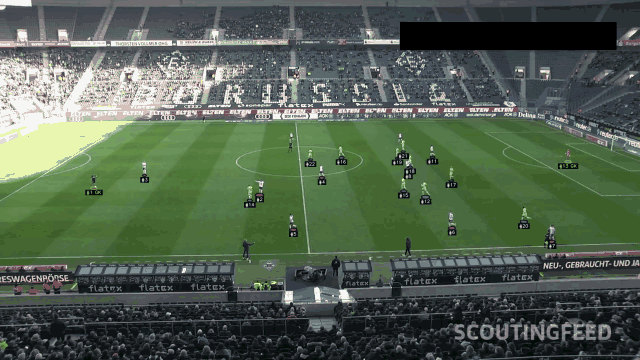
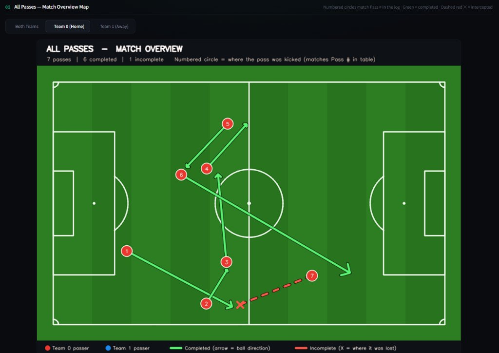
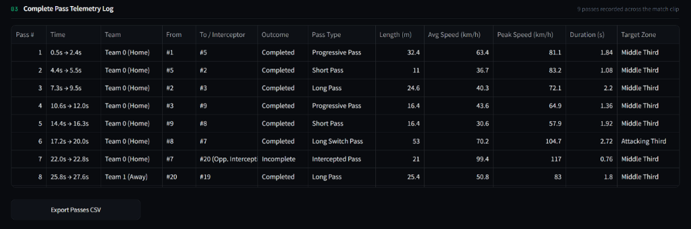
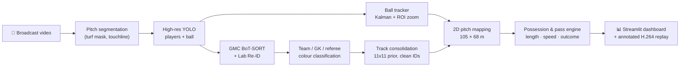

<div align="center">

# ⚽ Footballistic

### Broadcast-grade football analytics from a single camera feed

Detect and track every player and the ball, identify teams, map the action onto a 2D pitch,<br>
and break down every pass — **who, to whom, how far, how fast, and whether it arrived.**

[](https://www.python.org/)
[](https://github.com/ultralytics/ultralytics)
[](https://github.com/ultralytics/ultralytics)
[](https://streamlit.io/)
[](LICENSE)

<br>



<sub>First 12 seconds of an analysed Bundesliga broadcast clip — stable player IDs, team colours, GMC-pinned movement trails and the white ball trail.
<a href="docs/assets/demo_sample_12s.mp4">Watch the full-quality MP4 →</a></sub>

</div>

---

## ✨ Why Footballistic?

Professional match analytics (Opta, StatsBomb, Second Spectrum) depends on human event-taggers or multi-camera optical systems installed in elite stadiums.
**Footballistic** asks a simple question: *how much of that can be recovered from ordinary broadcast video?*

| | |
|---|---|
| 🎯 **Tracks everyone** | Close **and** distant players, kept on the same ID through fast camera pans |
| ⚽ **Tracks the ball** | A dedicated tracker with a white comet trail, ~95 % frame coverage on the demo clip |
| 👕 **Knows the teams** | Jersey-colour clustering separates both teams, goalkeepers, referees and coaching staff |
| 🗺️ **Thinks in 2D** | Everything is projected onto a FIFA-sized 105 × 68 m pitch for tactical views |
| 📏 **Measures passes** | Per-pass length (m), ball speed (km/h), flight time and outcome — each with its own freeze-frame |
| 🖥️ **Explorable** | A minimal, dark, no-sidebar Streamlit dashboard with CSV export |

---

## 🖥️ Dashboard Tour

### 1 · Pass-by-pass tactical inspector
Every detected pass gets its own bird's-eye freeze-frame: all 22 players at the moment of the kick, the real ball path, the passer, the receiver (or interceptor), and the telemetry — next to a real broadcast frame for verification. Step through the match with the ← / → buttons.

<p align="center">
  
  
</p>
<p align="center"><sub><b>Left:</b> a completed 24.6 m pass (#2 → #3). <b>Right:</b> a pass by #7 intercepted by opponent #20 — shown with a dashed red ball path and a ✕.</sub></p>

### 2 · Every pass on one pitch + full telemetry log
All passes of the clip on a single map (numbered circle = where it was kicked, green = completed, dashed red ✕ = intercepted), plus a complete log with **From → To**, **Outcome**, **Length**, **Avg / Peak speed**, **Duration** and **Target zone**, exportable as CSV.

<p align="center">
  
</p>
<p align="center">
  
</p>

### 3 · Team analytics
Average formation, convex-hull team shape, centroid, block depth/width, a collective occupancy heatmap, and channel / pitch-depth distribution — for either team or both side by side.

<p align="center">
  
  
</p>

### 4 · Player deep-dive
Pick any player: movement trajectory, individual heatmap, estimated distance, average speed, tactical corridor and pitch-thirds split.

<p align="center">
  
  
</p>

---

## 🧠 How It Works



The pipeline runs in two passes: **Pass 1** detects, tracks and classifies (and caches the result), **Pass 2** renders the annotated video and exports the spatial data the dashboard reads.

---

## 🛠️ Engineering Challenges We Solved

Broadcast football is a hostile environment for computer vision. These are the problems the project is built around:

| Challenge | How it is handled |
|---|---|
| **Small, distant players** are missed by standard detectors | Detection is run on the *pitch-cropped* image at `imgsz=1280` with a low confidence floor and a second-stage recovery pass |
| **Crowd, ad boards, dugouts, coaches** create false players | A non-convex turf mask (immune to green LED boards) plus a RANSAC white-touchline detector rejects anything off the pitch |
| **Camera pans reshuffle IDs** | BoT-SORT with sparse-optical-flow **camera-motion compensation**, foot-position + CIE Lab jersey Re-ID, and global tracklet consolidation with an 11-player prior |
| **The ball is tiny, fast, often occluded** | A dedicated tracker: camera-compensated Kalman filter, native-resolution ROI zoom, motion/white-blob recovery and **penalty-spot rejection** |
| **White kits vs. white ad boards / lime-green kits vs. turf** | Local-turf-subtracted colour extraction and lopsided-cluster protection in K-Means |
| **A long ball flying over a bystander** looks like a touch | A kinematic *fly-over filter* checks the ball's speed and bend before, during and after the contact |
| **Passes measured between control halos give absurd speeds** | Exact *kick* and *reception* frames are pinpointed, so speed uses true flight time |

---

## 📊 Results on the Demo Clips

| | `sample.mp4` (broadcast) | `sample2.mp4` (wide tactical) |
|---|:---:|:---:|
| Players tracked | **22** (11 v 11) | **22** (11 v 11) |
| Ball coverage | **94.9 %** (712 / 750 frames) | ~85–91 % |
| Passes detected | **9** (8 completed · 1 intercepted) | **5** (4 completed · 1 intercepted) |
| Pass accuracy | 88.9 % | 80.0 % |
| Avg pass length / speed | 24.0 m · 52.9 km/h | 29.1 m · 39.6 km/h |
| Longest pass | **53.0 m** cross-field switch | — |

> These are short 30-second clips used to validate the pipeline; the numbers illustrate behaviour, not a formal benchmark.

### How pass length and speed are measured
1. The exact frame the ball **leaves the passer's foot** and the frame it **reaches the receiver / interceptor** are pinpointed.
2. Camera coordinates are mapped onto a 105 × 68 m pitch using a perspective-aware projection.
3. **Length** = straight distance between those two points; **speed** = ball-path distance ÷ true flight time (average and peak are both reported).

---

## 🚀 Quick Start

```bash
git clone https://github.com/omerfarukyuce/Footballistic.git
cd Footballistic

python -m venv venv
venv\Scripts\activate          # Windows   (Linux/macOS: source venv/bin/activate)
pip install -r requirements.txt
```

**1. Add a match clip** (any wide-angle / broadcast `.mp4`) under `data/sample_videos/`, and a YOLO checkpoint such as `yolo11m.pt` under `weights/`.
A helper is included for the demo clip: `python scripts/download_sample.py`.

**2. Run the pipeline** (≈ minutes on CPU for a 30 s clip):
```bash
python main.py --video data/sample_videos/sample.mp4 --output output
```

**3. Open the dashboard:**
```bash
streamlit run app.py
```

From the dashboard you can switch between processed matches, upload your own video, choose `YOLO11m` or `YOLOv8m`, inspect passes one by one, explore team and player analytics, watch the annotated replay and export everything to CSV.

> Processed outputs (`output*/`) and large media are git-ignored, so run step 2 once before launching the dashboard.

---

## 🗺️ Roadmap

### Phase 1 — Core vision pipeline ✅
- [x] Pitch-cropped, high-resolution YOLO detection with turf / touchline / LED-board immunity
- [x] Camera-motion-compensated BoT-SORT with Lab Re-ID and 11 v 11 consolidation
- [x] Dedicated ball tracker with white comet trail
- [x] Team, goalkeeper and referee classification
- [x] 2D pitch mapping, formations, heatmaps and an H.264 annotated replay

### Phase 2 — Events & pass intelligence ✅
- [x] Possession engine (player & team ownership, possession %)
- [x] Physics-verified individual passes — completed **and** intercepted — with length, speed, duration and a freeze-frame per pass
- [x] Interceptions / recoveries, progressive passes, final-third and box entries

### Phase 3 — Physical & tactical metrics 🚧
- [x] Distance, average speed, pitch presence, tactical thirds and channels
- [ ] Speed zones, top speed, sprint and high-intensity-run counts
- [ ] Defensive-line height, compactness over time, pressing intensity

### Phase 4 — Match centre 🚧
- [x] Minimal Streamlit studio: pass inspector, overview map, telemetry log, team & player analytics, CSV export
- [ ] One-click printable PDF / HTML scouting report

### Phase 5 — Pro-grade calibration (future)
- [ ] Automatic pitch-keypoint homography for exact metric projection across any pan / zoom
- [ ] Jersey-number OCR to link track IDs to real squad numbers

---

## ⚠️ Current Limitations

Being upfront about what the system does **not** do yet:

- The pitch mapping is a perspective-aware approximation, **not** a per-frame keypoint homography — distances and speeds are estimates, most reliable near mid-pitch.
- The ball is tracked in 2D; aerial height is not modelled, so lofted passes are measured along the ground projection.
- Player IDs are stable *labels* (`#1`–`#22`), not real shirt numbers.
- Evaluated on short clips from two camera setups — broader validation is on the roadmap.
- Runs on CPU by default; a GPU makes the pipeline much faster.

---

## 📁 Repository Structure

```text
Footballistic/
├── .streamlit/config.toml            # Dashboard theme
├── configs/football_botsort.yaml     # GMC BoT-SORT configuration
├── docs/assets/                      # README screenshots & demo clip
├── scripts/download_sample.py        # Demo clip helper
├── src/
│   ├── detection/                    # High-res YOLO · pitch & touchline segmentation
│   ├── tracking/                     # GMC BoT-SORT · ball tracker · track stitching
│   ├── team_assignment/              # Lab K-Means team / GK / referee classifier
│   ├── homography/pitch_view.py      # 2D pitch, heatmaps, per-pass freeze-frames
│   ├── analysis/                     # Spatial metrics · possession & pass engine
│   └── utils/                        # Broadcast drawing · H.264 video I/O
├── main.py                           # Two-pass pipeline entrypoint
├── app.py                            # Streamlit match centre
└── requirements.txt
```

---

## 🤝 Contributing

Issues, ideas and pull requests are welcome — see the [issues page](https://github.com/omerfarukyuce/Footballistic/issues).

## 📄 License

Released under the [MIT License](LICENSE).
Sample clips are short broadcast excerpts (DFL Bundesliga / Roboflow football dataset) used for demonstration purposes only.
